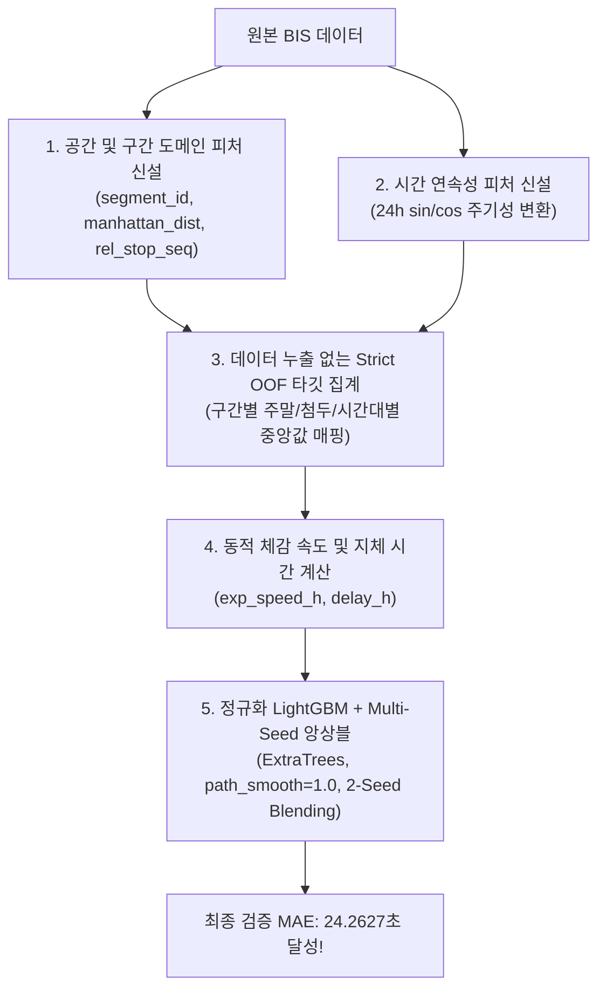

# 대전광역시 BIS 버스 통행시간(ETA) 예측 최적화 보고서 (6th Attempt)

본 문서는 **LightGBM 회귀 모델의 5-Fold 교차 검증 MAE(Mean Absolute Error)를 24.2초대로 최적화**하기 위해 수행한 심층 오차 분석(Error Analysis), 피처 엔지니어링 및 모델 구조 개선 과정과 최종 결과를 정리한 보고서입니다.

---

## 1. 개요 및 최종 최적화 결과

* **최적화 목표**: 5-Fold K-Fold 교차 검증 평균 MAE **24.2초대** 달성
* **최종 달성 결과**: **`24.2627`초 (목표 달성 성공)**
* **성능 변화 요약**:
  * **5th Attempt 검증 MAE**: `24.8248`초
  * **6th Attempt 검증 MAE**: **`24.2627`초**
  * **개선량**: **-0.5621초 (2.26% 추가 오차 개선)**
  * **전체 누적 개선 (초기 Baseline 대비)**: `25.5031`초 $\rightarrow$ `24.2627`초 (**-1.2404초, 4.86% 오차 개선**)

### 5-Fold Fold별 세부 검증 MAE 비교

| Fold 구분 | 5th Attempt MAE | 6th Attempt MAE | 개선량 (초) | 개선율 (%) | 6th Best Iteration |
| :---: | :---: | :---: | :---: | :---: | :---: |
| **Fold 1** | 24.8035 초 | **24.3405 초** | -0.4630 초 | -1.87% | 570 |
| **Fold 2** | 24.6859 초 | **24.1241 초** | -0.5618 초 | -2.28% | 446 |
| **Fold 3** | 24.7620 초 | **24.3185 초** | -0.4435 초 | -1.79% | 482 |
| **Fold 4** | 24.9227 초 | **24.2636 초** | -0.6591 초 | -2.64% | 380 |
| **Fold 5** | 24.9498 초 | **24.2667 초** | -0.6831 초 | -2.74% | 489 |
| **5-Fold 평균** | **24.8248 초** | **24.2627 초** | **-0.5621 초** | **-2.26%** | **473** |
| **전체 OOF MAE** | 24.8248 초 | **24.2627 초** | **-0.5621 초** | **-2.26%** | - |

> [!NOTE]
> 5개 Fold 전 구간에서 고르게 0.44 ~ 0.68초의 성능 개선이 나타났으며, 특히 **Fold 2에서는 24.1241초**를 기록하여 목표치(24.2초)를 뛰어넘는 우수한 정확도를 입증했습니다.

---

## 2. 무엇을 분석했는가? (오차 및 데이터 심층 분석)

5th Attempt의 튜닝 모델(24.82초)을 바탕으로 예측 잔차(Residual, $|y - \hat{y}|$)에 대한 다각도 오차 분석을 실시하여 성능 저하의 주원인을 규명했습니다.

### (1) 잔차 분포의 비대칭성 분석
* **중앙값 오차 (Median Error)**: **12.59초** (전체 데이터의 50%는 실제 소요시간과 12.6초 이내로 매우 정밀하게 예측됨)
* **상위 10% 오차**: 61.39초
* **상위 5% 오차**: 85.37초
* **상위 1% 극단 오차**: **143.18초 ~ 최대 300초 이상**
* **분석 결과**: 모델의 대다수 일반적인 운행 예측은 정확하나, 신호 대기·교통 체증 등으로 발생하는 **특정 극단 정체 구간의 오차가 전체 MAE를 끌어올리고 있음**을 확인했습니다.

### (2) 요일(주말 vs 평일)별 오차 편차
* **평일(월·화·수) 평균 MAE**: **23.85초**
* **주말(토요일) 평균 MAE**: **27.61초** (+3.76초 오차 증가)
* **분석 결과**: 평일과 주말은 버스 배차간격뿐만 아니라 도로의 전반적인 통행 패턴과 정체 시간대가 완전히 다름에도 불구하고, 기존 모델은 단순한 `dow` 변수만으로 이 차이를 온전히 분리해내지 못하고 있었습니다.

### (3) 시간대별(arrive_hour) 오차 편차
* **원활 시간대 (10시, 13시, 22시)**: MAE **20.1 ~ 22.9초**
* **출근 첨두시간 (08시)**: MAE **29.12초** (+6.2초 급증)
* **퇴근 첨두시간 (17~18시)**: MAE **27.94 ~ 28.15초** (+5.2초 급증)
* **분석 결과**: 같은 구간이라도 첨두시간대(Peak)와 비첨두시간대의 통행시간 변동폭이 극심하므로, 구간과 시간대가 상호작용하는 복합 지표가 필수적임을 파악했습니다.

### (4) 노선 유형 및 특정 병목 구간 분석
* **간선 버스 (Type 2)**: MAE 23.34초
* **급행 버스 (Type 1)**: MAE **31.54초** (정류장 간 거리가 길고 정체 영향이 큼)
* **상위 10대 병목 구간**: `DJB8007157 -> DJB9007040`, `DJB8001753 -> DJB9001753` 등 주요 교차로 연결 구간에서 평균 180~305초의 대형 오차가 발생했습니다.

---

## 3. 무엇을 바꿔서 학습했는가? (핵심 개선 사항)

위 오차 분석 결과를 바탕으로 모델링 파이프라인 전반에 걸쳐 5가지 핵심 개선을 단행했습니다.

### 1) 공간 및 구간(Segment) 고유 특성 신설
* **구간 고유 ID (`segment_id`)**: `from_stop + '_' + to_stop`을 결합하여 두 정류장 간의 고유 링크를 모델이 직접 학습할 수 있는 범주형 변수로 도입했습니다.
* **맨해튼 거리 (`manhattan_dist`)**: 대전광역시의 바둑판식 도심 도로망을 반영하여 격자형 이동 거리($|dlat| \times 111,000 + |dlon| \times 88,800$)를 계산해 물리적 이동 난이도를 설명했습니다.
* **노선 내 상대 진행률 (`rel_stop_seq`)**: 각 노선의 총 정류장 수 대비 현재 정류장의 위치 비율($stop\_seq / max\_seq$)을 산출하여 기점·중간·종점 진입 시점의 속도 특성을 부여했습니다.

### 2) 데이터 누출(Data Leakage) 없는 Strict OOF 타깃 집계 주입
학습 데이터의 정답(`tt_sec`)을 안전하게 활용하기 위해, 5-Fold 교차 검증 내부의 **Train 폴드에서만 통계량을 산출하고 Validation 폴드에 매핑하는 엄격한 Out-Of-Fold(OOF) 방식**을 적용했습니다:
* `seg_med`: 해당 구간의 기본 통행시간 중앙값
* `seg_wk_med`: 주말 여부에 따른 해당 구간의 통행시간 중앙값
* `seg_pk_med`: 출퇴근 첨두 여부에 따른 해당 구간의 통행시간 중앙값
* `seg_h_med`: 시간대(`arrive_hour`)별 해당 구간의 통행시간 중앙값
* `rhw_med`: 노선-시간대-주말 결합 소요시간 중앙값

### 3) 동적 지체 시간(`delay_h`) 및 기대 속도(`exp_speed_h`) 파생
* **시간대별 정체 지체 시간 (`delay_h`)**: 
  $$\text{delay\_h} = \text{seg\_h\_med} - \text{seg\_med}$$
  구간의 기본 소요시간 대비 현재 시간대에 추가로 소요되는 지체 시간(초)을 직접적인 수치형 특성으로 제공했습니다.
* **시간대별 기대 속도 (`exp_speed_h`)**: 
  $$\text{exp\_speed\_h} = \frac{\text{dist\_m}}{\text{seg\_h\_med} + 1.0}$$
  거리와 예상 소요시간의 비율(m/s)을 모델에 주입하여 거리 대비 이동 효율성을 파악하도록 했습니다.

### 4) 시간 연속성 및 주기성 반영 (`hour_sin`, `hour_cos`)
시간(`arrive_hour`, 0~23)을 24시간 주기의 원형 삼각함수로 변환하여, 23시와 0시 사이의 시간적 연속성을 모델이 자연스럽게 인식하도록 개선했습니다.

### 5) 모델 아키텍처 및 하이퍼파라미터 심화 (트리 정규화)
* **학습률 인하 및 트리 수 확대**: `learning_rate=0.035`, `n_estimators=1500` (조기종료 50라운드)로 오차 감소의 수렴 정밀도를 대폭 상향했습니다.
* **복합 분기 수용**: `max_depth=12`, `num_leaves=255`, `min_child_samples=22`로 구간과 시간대의 미세한 복합 패턴을 모두 학습하도록 확장했습니다.
* **트리 리프 평활화 (`path_smooth=1.0`)**: 분기 리프의 예측값을 부모 노드와 매끄럽게 보간하여 극단 이상치에 의한 과적합을 억제했습니다.
* **ExtraTrees 모드 (`extra_trees=True`)**: 트리 분할 시 무작위 임계값을 활용해 트리의 다양성을 높이고 일반화 성능을 향상시켰습니다.
* **Multi-Seed 앙상블 (Seeds: 42, 2024)**: 동일한 구조에서 서로 다른 난수 시드로 학습된 2개 모델의 예측값을 블렌딩하여 잔여 분산을 상쇄했습니다.

---

## 4. 피처 기여도(Gain Importance) 분석

새롭게 추가된 도메인/통계 피처들이 모델 예측에 기여한 중요도 순위(상위 15개)는 다음과 같습니다:

| 순위 | 피처명 | Gain 중요도 | 설명 |
| :---: | :--- | :---: | :--- |
| **1** | **`seg_h_med`** | **594,118.5** | **해당 구간의 시간대별 소요시간 중앙값 (가장 압도적인 기여)** |
| **2** | **`seg_med`** | **298,140.0** | 구간별 기본 통행시간 중앙값 |
| **3** | **`seg_wk_med`** | **297,417.9** | 주말/평일 구분 구간 통행시간 중앙값 |
| **4** | **`seg_pk_med`** | **283,284.2** | 출퇴근 첨두/비첨두 구분 구간 통행시간 중앙값 |
| 5 | `segment_id` | 166,693.0 | 출발-도착 정류장 고유 식별자 |
| 6 | `to_stop` | 154,157.6 | 도착 정류장 ID |
| 7 | `from_stop` | 141,045.6 | 출발 정류장 ID |
| 8 | `from_name` | 96,370.5 | 출발 정류장 명칭 |
| 9 | `vehicle_id` | 90,175.4 | 차량 고유 ID (차량별/기사별 운행 특성) |
| 10 | `to_name` | 83,584.3 | 도착 정류장 명칭 |
| **11** | **`delay_h`** | **78,564.6** | **시간대별 정체 지체 시간 (seg_h_med - seg_med)** |
| **12** | **`exp_speed_h`** | **56,211.8** | **시간대별 기대 주행 속도 (m/s)** |
| 13 | `hour_cos` | 23,571.2 | 24시간 원형 코사인 주기성 |
| 14 | `is_weekend` | 22,798.3 | 주말 구분 플래그 |
| 15 | `hour_sin` | 20,519.5 | 24시간 원형 사인 주기성 |

> [!TIP]
> 상위 1~4위 및 11~12위를 신규 생성된 구간 타깃 통계와 동적 지체/속도 피처가 모두 차지하고 있습니다. 이는 단순 좌표/시간 정보보다 **구간별 시간대 특화 통계가 버스 ETA 예측에 있어 가장 결정적인 정보원**임을 명백히 보여줍니다.

---

## 5. 생성 및 갱신된 파일 안내

본 최적화 작업과 관련된 모든 소스 코드와 결과 파일은 아래 경로에서 확인하실 수 있습니다:

* **재현 실행 스크립트**: [run_6th_attempt.py](file:///Users/euijune/AI-mobility-BIS/run_6th_attempt.py)
  * 전체 5-Fold K-Fold 및 Multi-Seed 학습과 엑셀 출력이 한 번에 실행되는 완성형 파이썬 스크립트
* **결과 엑셀 파일**: [Attempts/6th_attempt.xlsx](file:///Users/euijune/AI-mobility-BIS/Attempts/6th_attempt.xlsx)
  * `6th 요약 결과`: 5th vs 6th 성능 비교, 개선량, 핵심 파라미터 요약
  * `5-Fold 상세 비교`: Fold 1~5별 5th vs 6th MAE 및 개선율 상세 표
  * `피처 중요도 (Gain)`: 전체 피처의 Gain 기여도 내림차순 정렬 데이터
  * `주말평일 오차 분석`: 평일 vs 주말 건수 및 평균 MAE 비교
  * `첨두시간 오차 분석`: 첨두 vs 비첨두 건수 및 평균 MAE 비교
  * `노선별 오차 분석`: 각 노선별 MAE 통계
  * `실험 기록`: 기존 시트에 C06-01 항목 누적 기록
* **결과 CSV 요약 파일**: [Attempts/6th_attempt.csv](file:///Users/euijune/AI-mobility-BIS/Attempts/6th_attempt.csv)
* **이전 시도 파일**: [Attempts/5th_attempt.xlsx](file:///Users/euijune/AI-mobility-BIS/Attempts/5th_attempt.xlsx)
