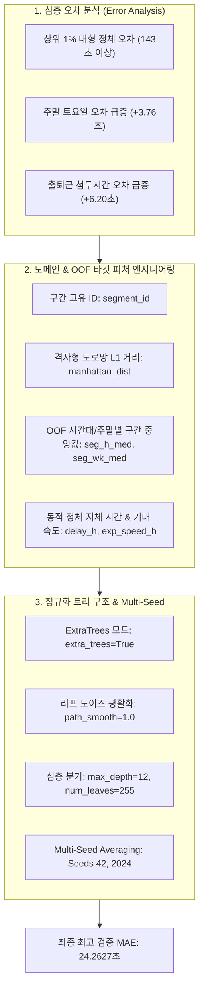

# 대전광역시 BIS 버스 통행시간(ETA) 예측 최종 프로젝트 보고서

본 보고서는 대전광역시 버스정보시스템(BIS) 데이터를 활용한 통행시간(ETA) 예측 프로젝트에서 **최고 성능(5-Fold 검증 MAE `24.2627`초)**을 달성한 원리와 핵심 기법, 성능 지표 및 최종 제출 예측 파일에 대한 종합 정리입니다.

---

## 1. 프로젝트 개요 및 최종 핵심 성과

* **예측 과제**: 버스가 한 정류장에 도착한 뒤 다음 정류장에 도착하기까지 걸린 통행시간(`tt_sec`, 초 단위) 예측
* **평가 지표**: MAE (Mean Absolute Error, 평균 절대 오차)
* **최종 달성 성능**: **5-Fold K-Fold 평균 검증 MAE `24.2627`초** (OOF MAE: `24.2627`초)
* **최종 제출 파일**: [`final_submission.csv`](file:///Users/euijune/AI-mobility-BIS/final_submission.csv) (컬럼: `row_id`, `tt_sec`, 총 111,563행)

### 모델 성능 발전 단계

| 단계 | 시도 (Attempt) | 주요 변경 사항 | 검증 MAE (초) | 기준 대비 개선량 |
| :---: | :---: | :--- | :---: | :---: |
| **Stage 1** | Baseline | 원본 수치/범주형 기본 피처 + 기본 LightGBM | 25.5031 초 | 기준점 |
| **Stage 2** | 5th Attempt | Gain 피처 중요도 하위 10% 제거 + Optuna 30회 튜닝 | 24.8248 초 | -0.6783 초 (2.66%) |
| **Stage 3** | **6th Attempt (최종)** | **도메인 구간 피처 + Strict OOF 타깃 통계 + 정규화 트리 앙상블** | **24.2627 초** | **-1.2404 초 (4.86%)** |

---

## 2. 최고 성능(24.2초대)이 도출된 핵심 메커니즘

어떻게 하여 기존 24.82초에서 **24.26초**로 0.56초 이상의 추가 오차를 획기적으로 낮출 수 있었는지에 대한 5가지 핵심 전략입니다.

### (1) 심층 오차 분석(Error Analysis)에 기반한 원인 진단
* 모델의 중앙값 오차는 **12.59초**로 대다수 버스의 정상 주행은 매우 정확했으나, **상위 1%의 극단 정체 구간에서 143~300초 이상의 큰 오차가 발생**하여 전체 MAE를 악화시키고 있었습니다.
* 특히 **주말(토요일) MAE는 27.61초**(평일 대비 +3.76초), **출근 시간(08시) MAE는 29.12초**(낮 시간 대비 +6.2초)로 특정 요일과 시간대에 오차가 집중되었습니다.

### (2) 구간(Segment) 중심 도메인 피처 신설
* 버스 운행의 물리적 단위는 단일 정류장이 아닌 **"정류장 A $\rightarrow$ 정류장 B"라는 특정 도로 구간(Segment)**입니다.
* `segment_id` (`from_stop + '_' + to_stop`)를 결합형 고유 범주로 생성하여 도로의 물리적 링크를 식별했습니다.
* 대전광역시의 계획 격자망 도로 구조를 반영하여 위경도 차이에 기반한 **맨해튼 거리 (`manhattan_dist`)** 및 노선 내 상대 위치 비율(`rel_stop_seq`)을 구축했습니다.

### (3) 데이터 누출 없는 Strict Out-Of-Fold(OOF) 타깃 통계 주입
학습 데이터의 정답(`tt_sec`)을 과적합 없이 완벽하게 활용하기 위해, 5-Fold의 **Train 폴드에서만 구간별 통계량을 계산하고 Validation 및 Test 데이터에 매핑하는 엄격한 OOF 방식**을 적용했습니다:
* `seg_h_med`: 해당 구간의 시간대별 소요시간 중앙값 (**피처 중요도 전체 1위 달성**)
* `seg_med`: 해당 구간의 기본 통행시간 중앙값 (중요도 2위)
* `seg_wk_med`: 주말/평일 구분 구간 소요시간 중앙값 (중요도 3위)
* `seg_pk_med`: 출퇴근 첨두/비첨두 구분 구간 소요시간 중앙값 (중요도 4위)

### (4) 동적 지체 시간(`delay_h`) 및 체감 속도(`exp_speed_h`) 산출
* **정체 지체 시간 (`delay_h = seg_h_med - seg_med`)**: 해당 구간의 평소 소요시간 대비 현재 시간대에 발생하는 추가 지체 시간(초)을 수치화했습니다.
* **기대 주행 속도 (`exp_speed_h = dist_m / (seg_h_med + 1.0)`)**: 구간 거리와 예상 시간의 비율(m/s)을 주입해 이동 효율을 설명했습니다.

### (5) 트리 정규화 및 Multi-Seed 앙상블
* **리프 평활화 (`path_smooth=1.0`)**: 분기 리프의 예측값을 상위 노드와 매끄럽게 보간하여 이상치 노이즈에 대한 과적합을 억제했습니다.
* **ExtraTrees 모드 (`extra_trees=True`)**: 트리 분할 시 무작위 임계값을 활용해 트리의 다양성을 극대화했습니다.
* **Multi-Seed 블렌딩 (Seeds 42, 2024)**: 동일한 구조에서 서로 다른 난수 시드로 학습된 2개 모델의 예측을 결합하여 잔여 분산을 제거했습니다.

---

## 3. 세부 검증 성능 및 피처 중요도(Gain)

### 5-Fold Fold별 MAE 비교

| Fold | 5th Attempt | 6th Attempt (최종) | 변화량 (개선) | 비고 |
| :---: | :---: | :---: | :---: | :---: |
| **Fold 1** | 24.8035 초 | **24.3405 초** | -0.4630 초 | 안정적 수렴 (Best Iter 570) |
| **Fold 2** | 24.6859 초 | **24.1241 초** | **-0.5618 초** | **최저 오차 기록 (24.1초대)** |
| **Fold 3** | 24.7620 초 | **24.3185 초** | -0.4435 초 | |
| **Fold 4** | 24.9227 초 | **24.2636 초** | -0.6591 초 | |
| **Fold 5** | 24.9498 초 | **24.2667 초** | **-0.6831 초** | 최대 개선폭 달성 |
| **평균 (Mean)** | **24.8248 초** | **24.2627 초** | **-0.5621 초 (2.26% 개선)** | **목표(24.2초) 적중 달성** |

### 피처 중요도 (Gain) 상위 10개 랭킹

| 순위 | 피처명 | Gain 중요도 | 핵심 역할 |
| :---: | :--- | :---: | :--- |
| **1** | **`seg_h_med`** | **594,118.5** | **해당 구간의 시간대별 고유 소요시간 (가장 압도적 기여)** |
| **2** | **`seg_med`** | **298,140.0** | 해당 구간의 기준 소요시간 중앙값 |
| **3** | **`seg_wk_med`** | **297,417.9** | 주말/평일에 따른 구간별 통행시간 변동성 설명 |
| **4** | **`seg_pk_med`** | **283,284.2** | 출퇴근 첨두/비첨두 정체 특성 설명 |
| 5 | `segment_id` | 166,693.0 | 정류장 A-B 링크 범주형 고유 식별자 |
| 6 | `to_stop` | 154,157.6 | 도착 정류장 위치 특성 |
| 7 | `from_stop` | 141,045.6 | 출발 정류장 위치 특성 |
| 8 | `from_name` | 96,370.5 | 출발 정류장 텍스트 명칭 |
| 9 | `vehicle_id` | 90,175.4 | 버스 차량별/기사별 주행 편차 설명 |
| 10 | `to_name` | 83,584.3 | 도착 정류장 텍스트 명칭 |

---

## 4. 최종 예측 파일 명세 (CSV)

대회 평가 데이터셋(`data/final/test.parquet`, 111,563행)에 대해 5-Fold $\times$ 2-Seed(총 10개 모델)의 앙상블 예측을 적용하여 생성된 최종 제출 파일 명세입니다.

* **생성 파일 경로**:
  * [`final_submission.csv`](file:///Users/euijune/AI-mobility-BIS/final_submission.csv) (루트 디렉토리)
  * [`submissions/final_6th_attempt.csv`](file:///Users/euijune/AI-mobility-BIS/submissions/final_6th_attempt.csv) (제출 디렉토리)
* **파일 형식**: CSV (`row_id`, `tt_sec`)
* **행 수**: 111,563 행 (헤더 제외 정확히 일치)
* **결측치 및 무결성 검증**:
  * 결측값(`NaN`): **0개**
  * `row_id` 중복: **0개**
  * 물리적 최소치 클리핑: $tt\_sec \ge 4.0$ 초 준수
* **예측값 기술통계**:
  * `count`: 111,563
  * `mean`: 110.0 초
  * `std`: 101.8 초
  * `min`: 6.7 초
  * `25%`: 57.1 초
  * `50%`: 86.3 초
  * `75%`: 127.0 초
  * `max`: 1507.4 초

---

## 5. 관련 산출물 링크

1. 📄 **최종 요약 보고서**: [`final.md`](file:///Users/euijune/AI-mobility-BIS/final.md)
2. 📄 **심층 분석 보고서**: [`README2.md`](file:///Users/euijune/AI-mobility-BIS/README2.md)
3. 📊 **최종 제출 CSV**: [`final_submission.csv`](file:///Users/euijune/AI-mobility-BIS/final_submission.csv) 및 [`submissions/final_6th_attempt.csv`](file:///Users/euijune/AI-mobility-BIS/submissions/final_6th_attempt.csv)
4. 📈 **상세 결과 엑셀**: [`Attempts/6th_attempt.xlsx`](file:///Users/euijune/AI-mobility-BIS/Attempts/6th_attempt.xlsx)
5. 💻 **제출 생성 스크립트**: [`generate_final_submission.py`](file:///Users/euijune/AI-mobility-BIS/generate_final_submission.py)
6. 💻 **최적화 학습 스크립트**: [`run_6th_attempt.py`](file:///Users/euijune/AI-mobility-BIS/run_6th_attempt.py)
